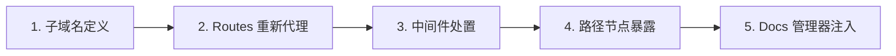
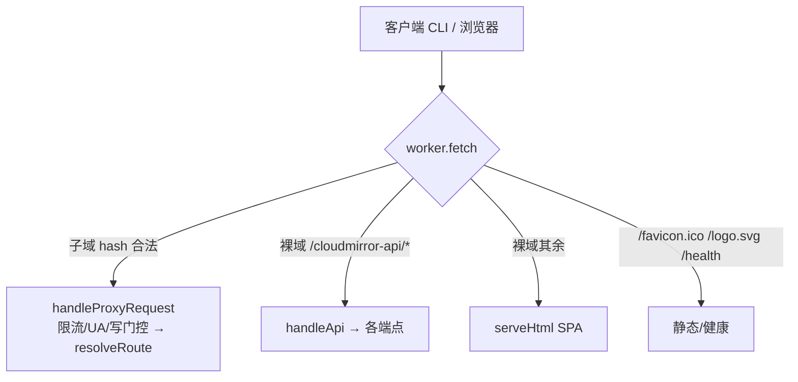
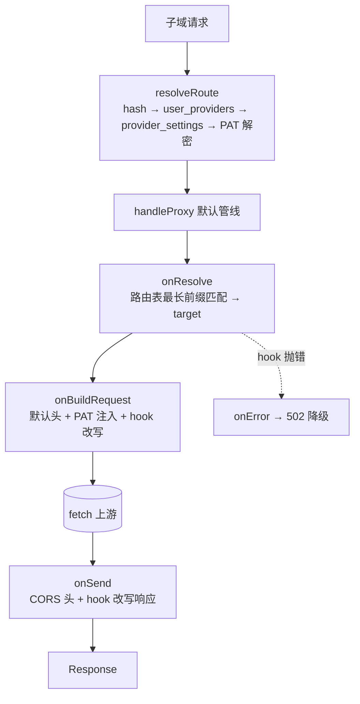
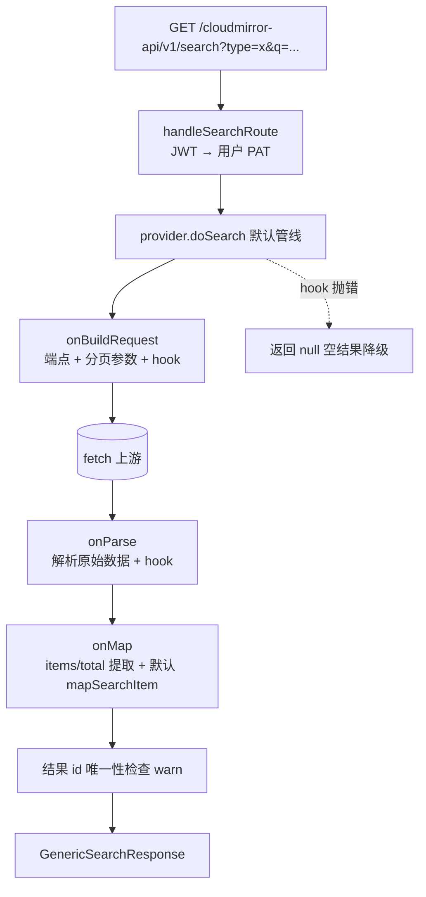
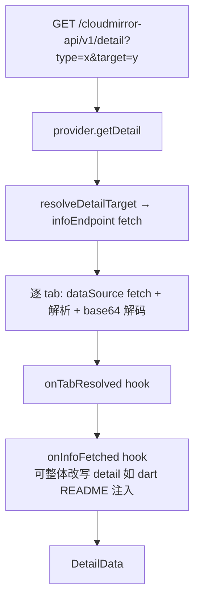
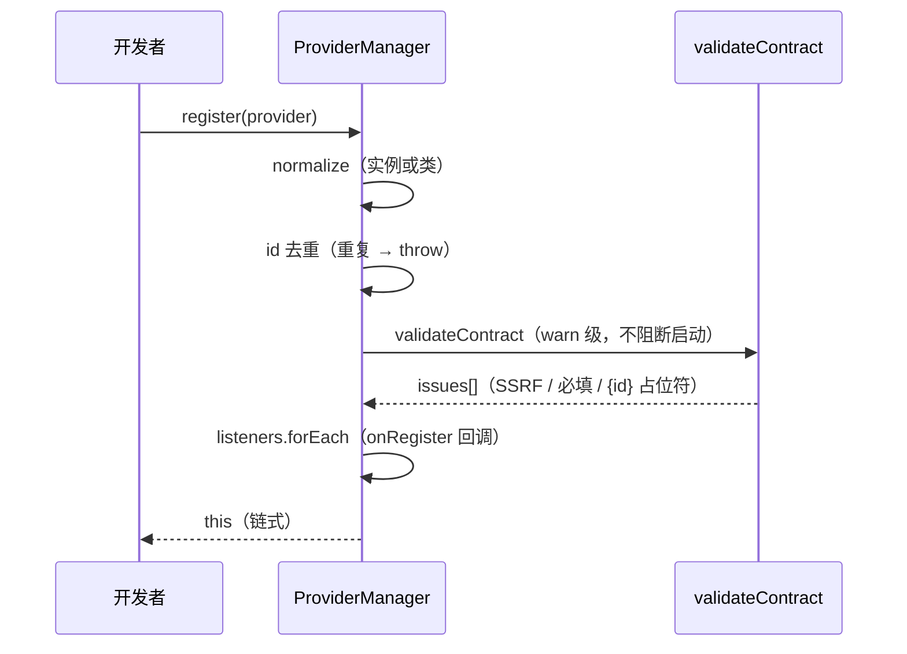

# cloudMirror 架构 · 最终设计方案稿

> **状态**: 权威（2026-08-01，SDK v2 已实施并全量回归）
> **定位**: 本文是 cloudMirror **当前架构的唯一权威基准**，用于指导今后的开发。所有新功能、新 Provider、新端点都以此为准。
> **配套文档**: `development.md`（开发规范）· `README.md`（部署指南）

---

## 目录

1. [架构总览](#1-架构总览)
2. [执行流程路径（全部）](#2-执行流程路径全部)
3. [核心组件与职责](#3-核心组件与职责)
4. [新增 Provider 开发基准](#4-新增-provider-开发基准)
5. [关键不变量与校验](#5-关键不变量与校验)
6. [测试基准](#6-测试基准)
7. [文档地图](#7-文档地图)

---

## 1. 架构总览

### 1.1 五层模型

cloudMirror 对每个源（Provider）做五层叠加：



| 层 | 含义 | 载体 |
|---|------|------|
| 1. 子域名定义 | 每个 `(user, provider)` 一个独立 `{hash}.mirror.example.com` | `worker/router.ts` `resolveRoute()` |
| 2. Routes 重新代理 | 把上游路径映射到镜像子域，按前缀路由到不同上游 host | `_base.ts` `proxy` 配置（routes/hooks） |
| 3. 中间件处置 | 鉴权（PAT 注入）、search 映射、CORS、限流、审计 | `handleProxy` 默认管线 + `worker/index.ts` 门控 |
| 4. 路径节点暴露 | CLI 直连的原 API 路径集合 | `proxy.routes`、`fetch.ts` 白名单（声明派生） |
| 5. Docs 管理器 | 面向用户的安装/使用文档 | `Docs.tsx` 消费 `renderDocs()` |

### 1.2 三态路由（核心约束）

worker 对每个请求按 **hostname + 路径前缀** 做三态判定，**子域判定必须优先**：

| 态 | 判定 | 归属 |
|---|------|------|
| **代理** | 子域 `{hash}.mirror.example.com/*` | Provider 路由表 |
| **平台 API** | 裸域 + `/cloudmirror-api/v1/*` | 平台自身 |
| **前端页面** | 裸域 + 其余路径 | SPA |

> **关键不变量**：代理路由表中的 `prefix` 是**上游路径**（如 cargo `/api/v1/`），平台 API 前缀是**平台命名空间**（`/cloudmirror-api/v1`）。子域只走代理态，裸域 `/cloudmirror-api/*` 只走平台态，二者永不相交。

### 1.3 分层原则

> **base = 纯执行管线（解析 + 拼接 + 调度到统一显示模板）；provider = 纯声明单元。**

- base 不承载任何跨源知识（字段路径、上游列表）。
- Provider 是唯一承载源知识的单元，全部用声明式配置 + 可选 hook 表达。
- 禁止向 base 添加跨源猜测列表。

---

## 2. 执行流程路径（全部）

### 2.1 路径 A：worker 请求分发（入口）



代码：`src/worker/index.ts`

```
parseHostname(hostname) ? 代理
  : pathname.startsWith("/cloudmirror-api/") ? 平台 API
  : SPA
```

### 2.2 路径 B：代理管线（子域请求）



代码：`src/providers/_base.ts` `handleProxy()`

- 默认管线阶段：`onResolve → 默认头构建 → onBuildRequest → fetch → onSend → 输出`
- 逃生舱：特殊 Provider 仍可整体覆写 `handleProxy`
- 审计日志（fire-and-forget）由 `worker/index.ts` 写入

### 2.3 路径 C：搜索管线



代码：`src/providers/_base.ts` `doSearch()`、`src/worker/api/search.ts`

分页模式（`SearchConfig.pagination`）：

| 模式 | 参数 | 适用 |
|------|------|------|
| `page` | `?page=N&per_page=M` | cargo、packagist |
| `offset` | `?size=M&from=(N-1)*M` | npm、maven、nuget |
| `none` | 仅页大小，page 恒 1 | gomod（token 分页不可回溯） |
| `token` | 预留 | — |

### 2.4 路径 D：详情管线



代码：`src/providers/_base.ts` `getDetail()`、`src/worker/api/detail.ts`、`src/components/StaticTabRenderer.tsx`

- 服务端一站式 fetch（info + 全部 tabs），前端零多次请求；前端 `StaticTabRenderer` 纯渲染服务端 `DetailTabData`（不发起任何上游请求）
- `DetailConfig.hooks.onInfoFetched`：dart 从 repository 拉上游 README 注入 readme tab
- ⚠️ 旧浏览器端 fetch 渲染组件 `TabRenderer.tsx`（v1.0 遗留）已删除——其 `fetchProxy` 消费路径由服务端一站式取代；`/fetch` 端点与白名单保留为运行时设施（MED-1/2/3 解决方案）

### 2.5 路径 E：fetch 代理端点 + 白名单派生

```
POST /cloudmirror-api/v1/fetch  { url, headers?, type? }
  → 校验 url.hostname ∈ ALLOWED_HOSTS（模块加载期由 collectProxyUpstreams() 派生）
  → 转发并回 CORS 头
```

代码：`src/worker/api/fetch.ts`、`src/providers/manager.ts`

白名单来源（`collectProxyUpstreams()`，注册完成后计算一次并缓存）：

```
每个 Provider:
  upstream
  proxy.routes[].upstream
  search.endpoint
  defineDetail().infoEndpoint 的 host
  defineDetail().tabs[].dataSource.endpoint 的 host
```

### 2.6 路径 F：Docs 渲染

```mermaid
flowchart TD
    REQ[/docs/:id] --> U[useAllProviders + loadHashes]
    U --> R[renderDocs provider + ctx<br/>domain/hash]
    R --> A[自动派生章节<br/>代理端点表镜像 URL / 搜索 API / 凭据 / 快速连接]
    R --> P[prose 章节<br/>docs().sections]
    A --> M[Markdown 渲染]
    P --> M
```

代码：`src/providers/docs-manager.ts`、`src/pages/Docs.tsx`

### 2.7 路径 G：注册与校验生命周期



代码：`src/providers/manager.ts`、`registry.ts`

---

## 3. 核心组件与职责

| 组件 | 文件 | 职责 |
|------|------|------|
| `ProviderDefinition` | `src/providers/_base.ts` | 抽象基类：代理/搜索/详情默认管线 + render/validateContract/docs 聚合 |
| `ProviderManager` | `src/providers/manager.ts` | 注册管理器：register/use/get/all/searchable/metas/onRegister/validate |
| `registry.ts` | `src/providers/registry.ts` | 注册链（manager.register 14 个源）+ 兼容导出 |
| `docs-manager.ts` | `src/providers/docs-manager.ts` | 文档自动派生 + prose 合并 |
| `shared/api.ts` | `src/shared/api.ts` | `PLATFORM_API_PREFIX` + `platformApi()` 单一事实源 |
| `shared/types.ts` | `src/shared/types.ts` | 全部契约类型（SDK v2 声明式配置 + RenderContract + Docs） |
| `worker/router.ts` | `src/worker/router.ts` | 子域解析 + PAT 解密 |
| `worker/api/*` | `src/worker/api/` | 平台 API 端点（search/detail/fetch/providers/auth/admin...） |

---

## 4. 新增 Provider 开发基准

### 4.1 步骤

1. 新建 `src/providers/<name>.provider.ts`，`extends ProviderDefinition`
2. 声明身份：`id` / `meta`（不含 searchApi/route，自动派生）/ `upstream` / `authMode`
3. 声明代理（多数源无需覆写 handleProxy）：
   ```ts
   readonly proxy: ProxyConfig = {
     routes: [{ prefix: "/xxx/", upstream: "https://..." }],
     exposeHeaders?: true,
     hooks?: { onBuildRequest?: (ctx) => ... },
   };
   ```
4. 声明搜索（单端点源）或覆写 `doSearch`（多端点/特殊源）：
   ```ts
   readonly search: SearchConfig = {
     endpoint: "https://...", pagination: "page" | "offset" | "none", ...
   };
   ```
5. 实现 4 个配置 getter：`defineResultMapping()` / `defineResultCard()` / `defineDetail()` / `defineSetupGuide()`
6. 可选：`definePopularSearches()` / `defineCredentialTypes()` / `docs()` / `resolveDetailTarget()`
7. `registry.ts` 注册：`manager.register(<name>Provider)`
8. 运行 `yarn typecheck` + `yarn vitest run src/providers` 验证

### 4.2 自动生效范围（注册即联动）

- 首页搜索标签、搜索结果页 Tabs、`/cloudmirror-api/v1/search`
- 上游管理页（启用/禁用、PAT、子域轮换）
- `/docs/:id`（DocsManager 自动派生 + prose）
- `/cloudmirror-api/v1/fetch` 白名单（`collectProxyUpstreams()` 自动收录）

### 4.3 命名与图标约定

- `meta.name` 标准全称（Maven Central）；`meta.label` 紧凑短名（Maven）
- 图标优先级：simple-icons → lucide → 自定义 svg → image；深色品牌色（siGithub/siRust）不设 `colored: true`
- 搜索结果版本号使用上游原值，不手动补 `v`

---

## 5. 关键不变量与校验

| # | 不变量 | 强制位置 |
|---|--------|---------|
| 1 | 子域判定先于平台 API 判定（三态路由顺序） | `worker/index.ts` |
| 2 | Provider id 全局唯一 | `manager.register` 抛错 |
| 3 | 端点协议必须 `https://` | `validateContract()` |
| 4 | 端点 host 不得为 IP/内网保留段（SSRF） | `validateContract()`（覆盖 upstream/proxy.routes/search/detail） |
| 5 | 搜索结果 id 唯一性（CRIT-2 防护） | `doSearch` 默认管线（warn） |
| 6 | hook 抛错不击穿管线（502/空结果降级） | `handleProxy`/`doSearch` 默认管线 |
| 7 | `detail.infoEndpoint` 及 tab 端点必须用 `{target}` 而非 `{id}` | `validateContract()` |
| 8 | 平台 API 路径统一经 `platformApi()` 派生 | `shared/api.ts` + `/site-info` |

---

## 6. 测试基准

| 层 | 文件 | 覆盖 |
|----|------|------|
| manager | `provider-sdk.baseline.test.ts` | 注册去重 / validate 全过 / render 聚合 / docs 可用 |
| pipeline | `provider-sdk.pipeline.test.ts` | 代理管线（路由匹配/hooks/502 降级）、搜索管线（分页参数）、SSRF 校验 |
| render | `provider-sdk.baseline.test.ts` | 契约完整性（itemsPath/detailLink/infoEndpoint/credentialTypes） |
| e2e | `worker/__tests__/api/*` | auth/credentials 集成（URL 为 `/cloudmirror-api/v1`） |

当前基线：`vitest run src/providers` **30 项全过**；全量 107 过 / 3 既有失败（crypto 空密码、auth register 模式，与 SDK 无关）。

---

## 7. 文档地图

| 文档 | 定位 | 维护 |
|------|------|------|
| **`architecture.md`（本文）** | 当前架构唯一权威基准 | 随架构演进更新 |
| `development.md` | 开发规范（环境/代码规范/测试/贡献流程） | 规范变更时更新 |
| `README.md` | 项目介绍与部署指南 | 发布/部署变更时更新 |
